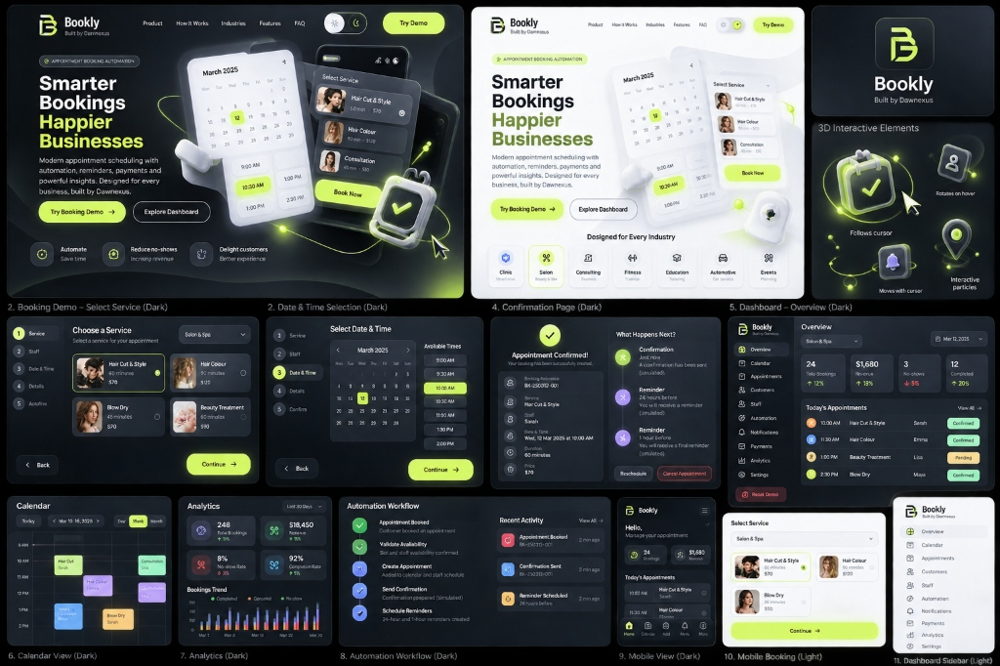

# Bookly — Appointment Booking Automation SaaS

> A tactile, interactive SaaS prototype built under the **[Dawnexus](https://dawnexus.in)** product showcase ecosystem.



## Overview

**Bookly** demonstrates an enterprise-grade appointment booking and scheduling automation platform designed for multi-industry operations. Prospective clients can explore an interactive booking engine, test real-time conflict avoidance, trigger automated customer and staff notification workflows, and operate a full-featured business dashboard with live metrics, analytics, calendar management, and waitlist handling.

## ✨ Key Capabilities

1. **Tactile Soft Neumorphic Design System**
   - Soft raised cards, recessed interactive controls, realistic lighting, and smooth depth.
   - Dual-theme system (**Light** & **Dark**) with real-time toggle and persistent local storage preferences.
   - Interactive 3D cursor-reactive hero visualization with smooth perspective transforms.

2. **Multi-Industry Deterministic Presets**
   - 7 distinct industry domains with dedicated services, staff rosters, durations, and pricing:
     - **Salon & Spa** (*LuxeGlow Studio*)
     - **Clinic & Healthcare** (*Apex Health Centre*)
     - **Consulting & Advisory** (*Vanguard Advisory*)
     - **Fitness & Training** (*Pulse Athletic Club*)
     - **Education & Tutoring** (*Strive Academy*)
     - **Automotive Care** (*Precision AutoWorks*)
     - **Events & Consultations** (*Aura Celebrations*)

3. **Realistic Staff Availability, Breaks & Leave**
   - Real-time slot conflict calculation with 10-minute automated schedule buffers.
   - Seeded staff shift hours, daily lunch breaks, and pre-booked busy periods (e.g. Sarah booked 09:00–11:00 AM with next availability at 11:30 AM).
   - Staff leave handling: on scheduled full-day leaves (e.g. Emma on March 12, 2025, Dr. Elena Gomez on Medical Symposium leave), conflicting booking slots are blocked, and alternative available colleagues are recommended.

4. **Purposeful Loading Skeletons & Microinteractions**
   - Reusable skeleton states matching exact component geometries (services, staff, calendar, summary, metrics, and automation feed) to eliminate cumulative layout shift (CLS = 0).
   - Microinteraction feedback: subtle scaling on hover (`1.02`), tactile compression on press (`0.98`), and reduced-motion compliance.

5. **Operational Business Dashboard**
   - **Overview**: 4 live KPI metric cards (Total Bookings, Revenue, No-shows, Completion Rate) and today's schedule.
   - **Interactive Calendar**: Day, Week, and Month matrix views with staff filters and quick slot booking.
   - **Appointments Management**: Status badges, search, filtering, and simulated rescheduling/cancellation.
   - **Automation Engine**: Multi-tier reminder pipeline (24-hour and 1-hour email/SMS simulation), waitlist slot-reallocation engine, and chronological activity feed.
   - **Analytics & Reporting**: Conversion funnels, provider utilization rates, bookings trend visualizations, and one-click CSV export.

## 🛠️ Tech Stack

- **Framework**: React 19 + TypeScript + Vite 8
- **Styling**: Tailwind CSS v4 with custom Neumorphic tokens
- **Routing**: React Router DOM v7 (SPA with Vercel rewrites)
- **Icons & Visuals**: Lucide React + Canvas Confetti
- **Testing**: Vitest unit test suite

## 🚀 Local Development

```bash
# Clone the repository
git clone https://github.com/azil0306az-rgb/booky-demo-app.git

# Navigate to project directory
cd booky-demo-app

# Install dependencies
npm install

# Start Vite development server
npm run dev

# Run unit test suite
npm test

# Build for production
npm run build
```

## 🌐 Attribution

Built with craft by **[Dawnexus](https://dawnexus.in)** showcase ecosystem.
